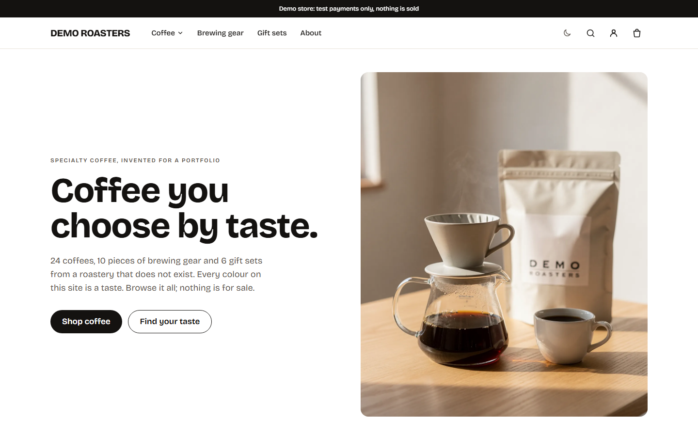
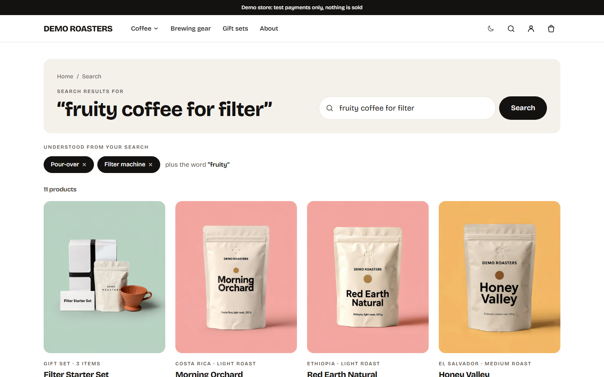
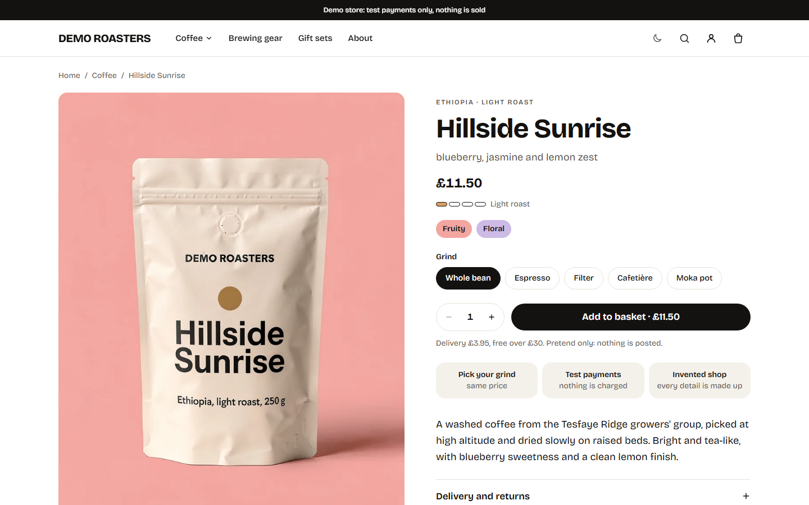
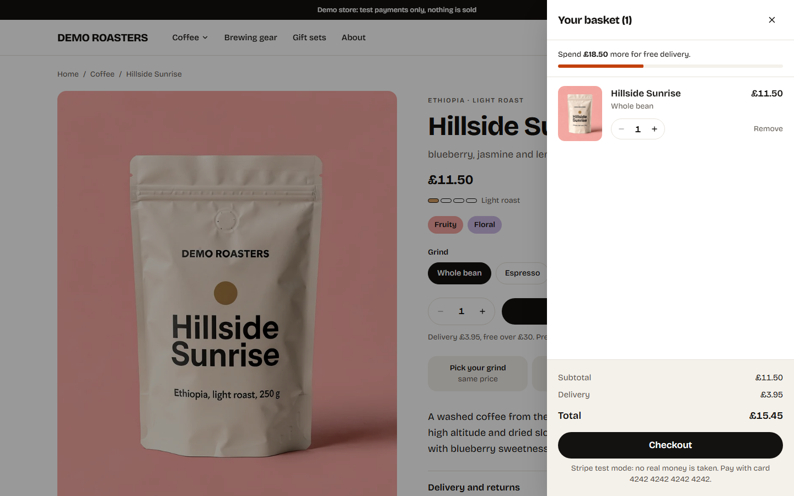
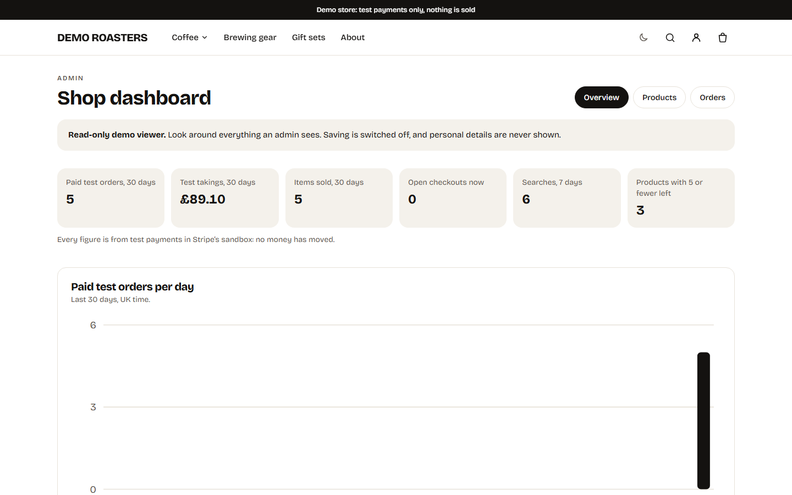
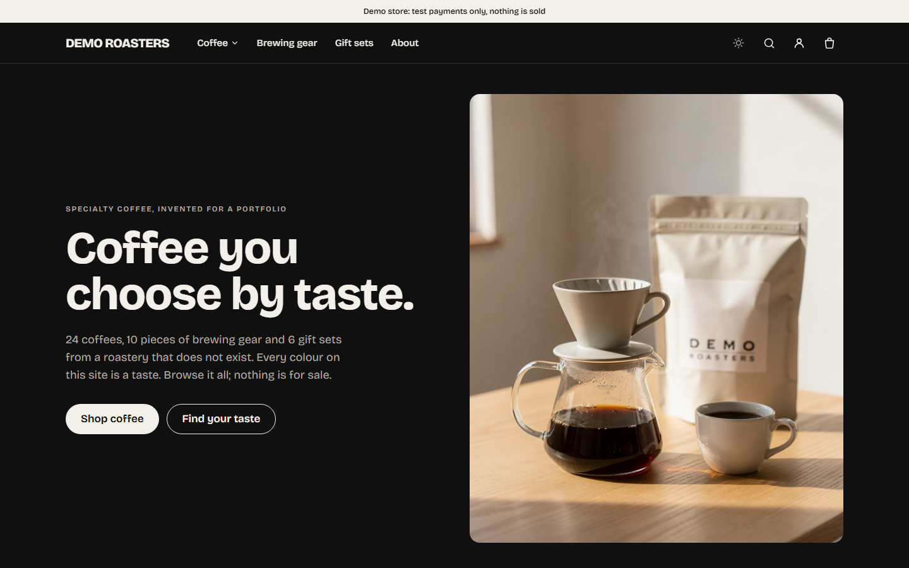
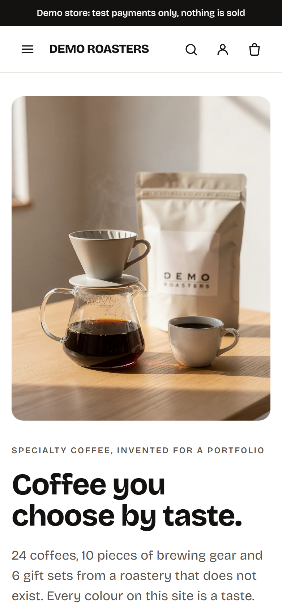
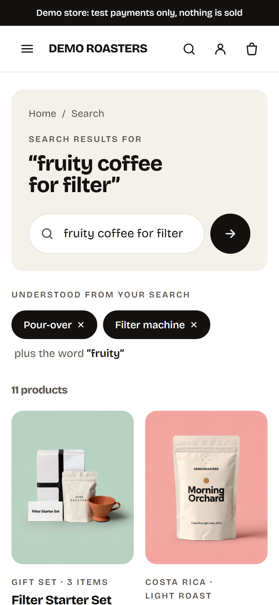

# Demo Roasters

Demo Roasters is a fictional UK specialty coffee shop, built as a portfolio demo. It sells nothing and takes no real money. Payments run on Stripe's test mode only, and every page says "Demo store: test payments only, nothing is sold". It shows a product catalogue, natural-language search, a basket and checkout, customer accounts and an admin dashboard. All 40 products, farms and people are invented.

A portfolio project by Cam, who led it and made the product, design and business decisions.

## Live demo

https://demo-roasters.vercel.app

The live site is open to search engines. This public repository is a fresh copy of the finished code; the full build history is kept privately.

## Try it

- Test card: `4242 4242 4242 4242`, any future expiry date, any CVC. No real card is ever charged.
- Demo customer: `customer@demo-roasters.example` / `try-the-demo-shop`
- Read-only admin viewer: `viewer@demo-roasters.example` / `look-but-dont-touch`

The sign-in page also has one-click buttons for both demo accounts. The viewer can look at the admin dashboard, but the server refuses every change it tries to make. Demo accounts reset nightly.

## Screenshots

<table>
  <tr>
    <td align="center" width="50%">
      
      <br><sub>Home</sub>
    </td>
    <td align="center" width="50%">
      
      <br><sub>Plain-English search</sub>
    </td>
  </tr>
  <tr>
    <td align="center" width="50%">
      
      <br><sub>Product page</sub>
    </td>
    <td align="center" width="50%">
      
      <br><sub>Basket</sub>
    </td>
  </tr>
  <tr>
    <td align="center" width="50%">
      
      <br><sub>Admin dashboard (read-only demo viewer)</sub>
    </td>
    <td align="center" width="50%">
      
      <br><sub>Dark theme</sub>
    </td>
  </tr>
  <tr>
    <td align="center" width="50%">
      
      <br><sub>Phone: home</sub>
    </td>
    <td align="center" width="50%">
      
      <br><sub>Phone: search</sub>
    </td>
  </tr>
</table>

## Features

- Catalogue of 40 invented coffees and kit, with filters, a taste filter and product pages. Product photos are AI-generated, and the home and About pages say so.
- Natural-language search that understands typos, price limits and words like "decaf".
- Basket kept on the visitor's device, with grind choice and per-product and per-order caps.
- Checkout through Stripe Checkout in test mode, with an order page that confirms payment with Stripe. An order is marked paid exactly once.
- Stock is reserved while a checkout is open. Holds use database row locks, so two visitors cannot take the last unit. One open checkout per connection, and holds never exceed half a product's stock.
- Customer accounts (email and password through Better Auth, no emails sent): order history and self-service deletion. Visitor accounts are deleted after 30 days.
- Admin dashboard: edit products (the search vector is rebuilt and the shop refreshes at once), stock, orders and a sales-by-day chart. A read-only viewer account is open to visitors.
- Light and dark themes and a phone layout, with automated accessibility checks in both themes.
- A nightly clean-up job that enforces retention periods.

## How search works

Search uses no paid AI. Two free parts work together.

1. A parser reads the query for things it can be sure about: price limits ("under 10 quid"), decaf, origin, brew method and similar. These become hard filters in SQL. They always win: a result that breaks a filter is never shown, and out-of-stock products are never shown.
2. A small embedding model, `gte-small` (a quantised ONNX file of 34 MB), runs on the server. It turns the query and each product's description into numbers, so "fruity coffee for filter" can match a coffee described as blueberry and jasmine. Its scores are blended with keyword ranking, and weak matches are cut off.

Search words are not stored. Each connection has a daily limit on meaning searches and falls back to keyword search after that, so the free hosting is not used up.

## Stack

| Part | What is used |
|---|---|
| Framework | Next.js 16.4.2, React 19.2.8, TypeScript 5.9.3 |
| Styling | Tailwind CSS 4.3.3 |
| Sign-in | Better Auth 1.7.7 |
| Database | Neon Postgres 18 with pgvector, London (`aws-eu-west-2`), through Drizzle ORM 0.45.4 and `pg` |
| Payments | Stripe 23.0.0, sandbox (test mode) only |
| Search model | `@huggingface/transformers` 4.3.1 with `Xenova/gte-small` |
| Hosting | Vercel Hobby (free plan), functions in London |
| Tests | Vitest 5.0.4, Playwright 1.64.0 with axe-core, Lighthouse 13.5.0 |

## Quality and measured results

Measured 26 October 2026, after the final security fixes.

- Locked search test: 16 of 20 queries passed, with 0 rule violations (nothing out of stock and nothing over a price limit was shown). The target was 18, so the test missed it. The 20 queries were written before any search code and were never tuned against. The free search was kept by choice rather than adding paid AI.- Lighthouse mobile, median of 5 runs. Performance: 95 home, 93 coffee page, 91 product page, 98 search. Accessibility 100 and best practices 100 on all four.
- Tests, all passing: 224 unit, 54 integration, 136 end-to-end. The end-to-end tests include axe accessibility checks in light and dark themes at phone and desktop widths.

## Security and privacy

A security and UK legal review was done on 26 October 2026. Every high and medium finding was fixed test-first or accepted with a written reason. See `docs/SECURITY-REVIEW.md`.

- Stripe test mode only. The code refuses any key that does not start `sk_test_`, `rk_test_` or `pk_test_`.
- Secrets live in `.env.local` (git-ignored) and Vercel environment variables, never in the repository. The whole git history was scanned for secrets.
- Rate limits use salted hashes of the connection, not raw addresses. Sessions store no user agent or IP address. Search text is not stored.
- Security headers include a Content-Security-Policy and HSTS. The privacy page lists each record kept and for how long.
- Not audited by an outside security firm. The reviews were three separate passes: security, UK legal, and an adversarial review of payments and data.

## Running locally

You need Node 22 or newer and your own Neon Postgres database. Create `.env.local` in the project root with these variables (names only, no values here): `DATABASE_URL`, `DATABASE_URL_UNPOOLED`, `BETTER_AUTH_SECRET`, `IP_HASH_SALT`, `CRON_SECRET`, `STRIPE_SECRET_KEY` (a test key) and optionally `STRIPE_WEBHOOK_SECRET` and `HF_TOKEN`.

```
npm install
npm run fetch:model
npm run db:migrate
npm run db:seed
npm run db:seed-accounts
npm run dev
```

The database scripts include a guard that refuses to run against any database except the project's test database. Pointing them at a different database needs a change to the guard in `src/lib/guards.ts` (unverified for a fresh clone).

Checks:

```
npm run verify
npm run test:integration
npm run e2e
npm run eval:locked
```

`npm run verify` runs lint, types, unit tests, a build and a secret scan. Integration tests need the database in `.env.local`.

## Licence and credits

- Product photos were generated with FLUX.2 [pro] by Black Forest Labs. Their terms allow the outputs to be used, including commercially (checked during the build).
- Everything else is invented: the shop, the products, the farms and the people. Any resemblance to real businesses is accidental.
- No ratings, reviews or testimonials appear anywhere, because there are none.
- No licence is granted: all rights reserved. You are welcome to read the code.
